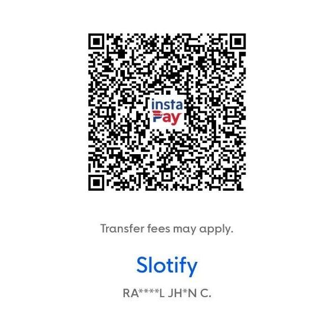

# Slotify

**A free, open-source centralized coinslot system for Windows pisonet and
rental shops.**

There's one coin box for the whole shop. The customer taps **Insert Coin** on
their PC or Android tablet, drops the coin at the counter, and the time goes
to their unit. One server screen shows every station, its time and the
prices.

- No license fee, no monthly fee, no activation
- One ESP32-based coinslot for every unit, built from parts you can buy locally
- The coinslot is **physically locked** until someone taps Insert Coin, and it rejects coins if the box loses power or restarts
- Coins are saved in the box and credited after Wi-Fi or server outages
- Windows PCs (works on iCafe8 diskless) and Android tablets in kiosk mode
- Runs on the shop LAN. No internet needed.

## Status

| | |
|---|---|
| **Tested** | One shop: 12× Windows 10 PCs on **iCafe8 diskless**, Android tablets, one **Allan 1239A Pro Max** |
| **Not yet tested** | Traditional (own-drive) PCs, other diskless systems (CCBoot, etc.), Deep Freeze, other coin acceptors |

If you run it on one of the untested setups, please send a
[tester report](CONTRIBUTING.md).

## Get started

- **Shop owners:** download the files from **[Releases](../../releases)**, then
  follow **[docs/OWNER-GUIDE.md](docs/OWNER-GUIDE.md)**. It covers parts,
  coin-box wiring, flashing, installing, and testing.
- **Coin box wiring:** [all-in-one diagram](docs/images/wiring-all-in-one.png)
  or the [step-by-step wiring page](https://rjcantare.github.io/Slotify/wiring.html).
- **Hardware details:** [docs/hardware/](docs/hardware/)

## What's in this repo

| Folder | What | Built with |
|--------|------|-----------|
| `windows/` | Server (WPF admin), Windows client (lock screen), shared code, tests, Inno Setup installers | .NET 8 |
| `android/` | Tablet/phone app (Device Owner kiosk) | Kotlin, Gradle |
| `firmware/` | ESP32 coin box firmware | PlatformIO / Arduino |
| `docs/` | Owner guide, wiring, coin acceptor spec | |
| `hardware/coin-box-board/` | Custom PCB for the coin box (Gerbers + printable PDF) | Python script |

### How it fits together

```
 [PCs: Windows client] ─┐
 [Tablets: Android app] ─┼── MQTT over shop LAN ──► [Server PC: Slotify Server + Mosquitto broker]
 [Coin box: ESP32]  ─────┘
```

The server grants an Insert-Coin "claim" to one station. The coin box
opens the slot, counts pulses (pesos), and reports them. The server credits
the claiming station and closes the slot.

## Building from source

```
dotnet test windows/RentalSystem.sln
powershell -ExecutionPolicy Bypass -File windows/installer/build-server.ps1
powershell -ExecutionPolicy Bypass -File windows/installer/build-client.ps1
cd android && ./gradlew :app:assembleDebug
cd firmware && cp include/config.example.h include/config.h && pio run -e esp32dev
```

## Security notes (read before deploying)

- **Change the default admin password.** It's `admin@123!` for the **Admin** button on
  every PC and tablet until you set your own on the server (**Setup → Tablet Admin**; it applies to PCs too).
  This repo is public, so everyone knows the default.
- **OTA updates of the coin box are disabled** in public builds
  (`OTA_PASSWORD ""`). If you enable it in your own build, use a unique
  password per shop.
- The MQTT broker runs **without authentication** by default. Anyone on the
  shop LAN can talk to it, so keep customer Wi-Fi off the shop network if you
  can.
- The server checks a GitHub-hosted manifest for new versions
  (`windows/src/RentalServer/OnlineUpdatePoller.cs`) and shows an update
  badge. If you fork, point it at your own releases repo.
- Release installers are not code-signed. Verify them with the SHA-256
  hashes on the Releases page.

## Support Slotify

Slotify is free and will stay free: no license, no monthly fee, no activation.
If it helps your shop and you want to support development (test hardware,
coin slots and tablets), you can send any amount by GCash or InstaPay.
It's optional, with nothing in return.



Other ways to help: star this repo, report bugs in
[Issues](https://github.com/rjcantare/Slotify/issues), or join as a tester
(traditional HDD/SSD setups and CCBoot are wanted most).

## License

[GPL-3.0](LICENSE). You may use, modify, share, and sell Slotify, but if you
distribute a modified version you must publish its source under the same
license. Provided **as-is, without warranty**. It handles real money, so
test it in your shop before relying on it.
