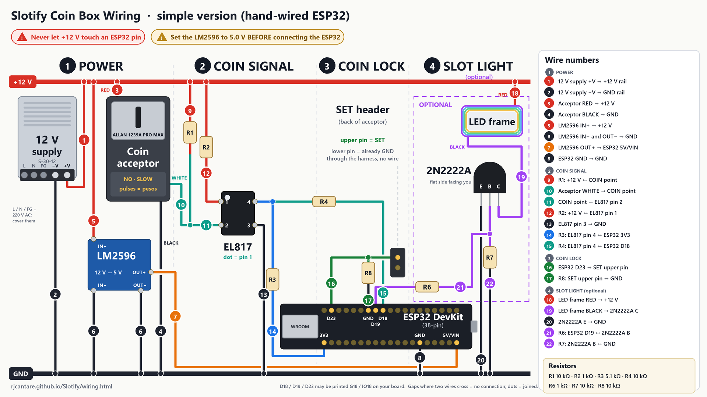
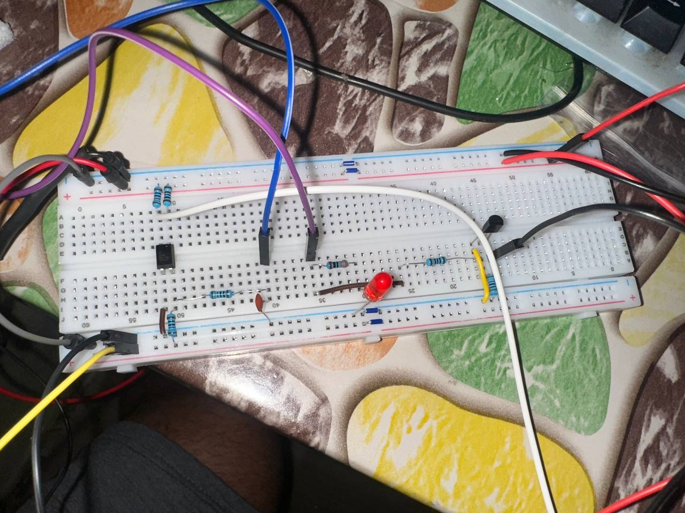
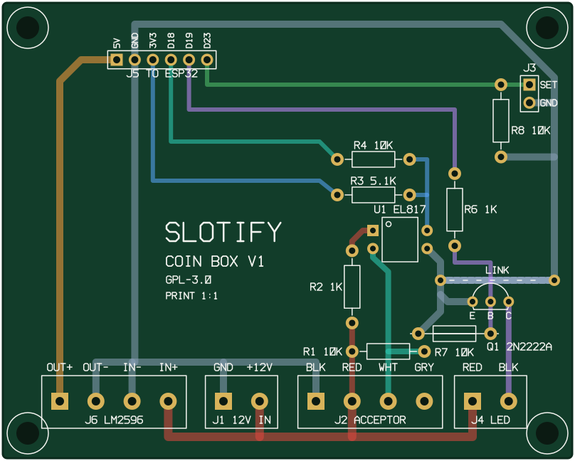
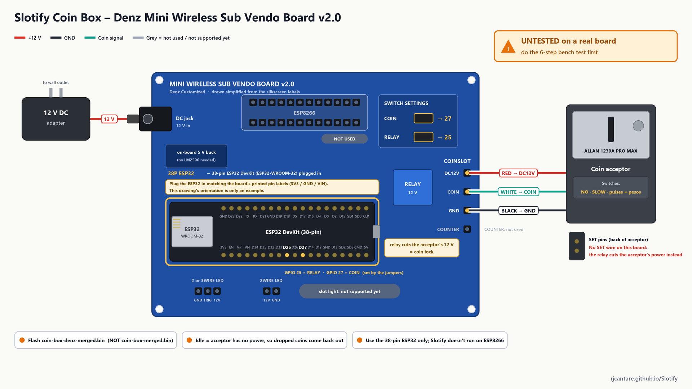

# Slotify: Owner Setup Guide

A free, open-source **centralized coinslot** system for Windows pisonet and
rental shops. There's **one coin box for the whole shop**: the customer taps
**Insert Coin** on their PC or tablet, drops the coin in the central coinslot,
and the time goes to their unit.

> **Tested so far:** our own shop. It runs **12 Windows 10 PCs, diskless
> (iCafe8)**, plus Android tablets, with one Allan 1239A Pro Max coinslot.
> **Not yet tested:** traditional setups (each PC with its own hard drive),
> other diskless systems (CCBoot, etc.), and other coin acceptor models. If you
> try one of these, please report it in [GitHub Issues](https://github.com/rjcantare/Slotify/issues).

**Time needed:** about 2–3 hours for the coin box (first build, with
soldering), 15 min for the server, 5 min per PC, 15 min per tablet.

---

## 1. Parts list

### Coin box

> **Printable checklist with search keywords:** [wiring page → Checklist ng bibilhin](https://rjcantare.github.io/Slotify/wiring.html#shopping).
> It also has the short lists for the [Slotify PCB](#28-option-slotify-pcb-v1-prototype) and the [Denz board](#29-option-denz-ready-made-board-untested) builds.

Hand-wired ESP32 build (tick as you buy):

| ✓ | Qty | Part | Exact spec / notes | Search keyword |
|---|---:|------|-------|----------------|
| ☐ | 1 | **Coin acceptor** | **Allan 1239A Pro Max** (HX-616 class). Must have the **SET** header on the back (the inhibit input). Comes with its 4-wire harness. Other models are untested. | `Allan 1239A Pro Max coin acceptor` |
| ☐ | 1 | **ESP32 board** | **ESP32-WROOM-32 DevKitC, 38-pin**, USB chip CH340 or CP2102 | `ESP32 38 pin DevKitC WROOM-32` |
| ☐ | 1 | **12 V power supply** | **S-30-12** (12 V 2.5 A, 220 V AC in) or equivalent. Powers everything. | `S-30-12 power supply 12V 2.5A` |
| ☐ | 1 | **Buck converter** | **LM2596 (HW-411)**, 12 V → 5 V for the ESP32. **Adjust it before connecting it** (§2.4). | `LM2596 buck converter HW-411` |
| ☐ | 1 | **Optocoupler** | **EL817 / PC817**, DIP-4. Protects the ESP32 from 12 V. **Required.** | `PC817 optocoupler DIP-4` |
| ☐ | 1 | **Transistor** | **2N2222A** NPN, TO-92. Switches the LED frame. | `2N2222A transistor TO-92` |
| ☐ | 4 | **10 kΩ resistor** | ¼ W: R1, R4, R7, R8 | `10k ohm resistor 1/4W` |
| ☐ | 2 | **1 kΩ resistor** | ¼ W: R2, R6 | `1k ohm resistor 1/4W` |
| ☐ | 1 | **5.1 kΩ resistor** | ¼ W: R3 | `5.1k ohm resistor 1/4W` |
| ☐ | 1 | Perfboard | About 30 × 70 mm, through-hole. Or use the [Slotify PCB](../hardware/coin-box-board/) instead. | `perfboard 5x7 cm` |
| ☐ | 1 | Screw terminal | 2-pin, 5.08 mm (12 V in) | `screw terminal block 5.08mm 2 pin` |
| ☐ | 2 | Female header strip | 1 × 19, 2.54 mm, to socket the ESP32 | `female header 1x19 2.54mm` |
| ☐ | 1 pack | Dupont jumper wires | Female-to-female (the SET wire) | `dupont jumper wire female to female` |
| ☐ | 1 set | Hookup wire | 22 AWG, red + black + one other colour | `22 AWG hookup wire` |
| ☐ | 1 | USB **data** cable | Micro-USB or USB-C to match your ESP32 (not charge-only), for flashing | `micro USB data cable` |
| ☐ | 1 | AC power cord with plug | For the supply's L / N / earth terminals | `3 core power cord with plug` |
| ☐ | 1 | Inline fuse holder + 1 A fuse | Recommended, on the AC live wire | `inline fuse holder 5x20mm` |
| ☐ | 1 | LED frame (optional) | 12 V frame for the coin slot. Lights while the slot is open. See the noise note in §2.6. | `Allan coin slot LED frame 12V` |
| ☐ | 1 | Coin box / enclosure | Holds the acceptor and the board | `coin box vendo cabinet` |
| ☐ | 1 set | Mounting | M3 screws and spacers, or hot glue / 3M VHB tape | `M3 brass standoff spacer` |

**Tools:** multimeter (**required**, for §2.4 and §2.5), soldering iron and
solder, small flat and Phillips screwdrivers, wire stripper/cutter,
heat-shrink or electrical tape for every 220 V and 12 V joint, and
optionally a hot glue gun.

All parts are sold on Shopee, Lazada and in local electronics shops. Prices change often, so check current listings.

### PCs, tablets, network

- **Server:** one always-on Windows 10/11 64-bit PC. In our shop it's the
  **iCafe8 diskless server**.
- **Rental PCs:** Windows 10/11 64-bit.
- **Tablets/phones (optional):** Android **8.0** or newer. Must be **factory
  reset** before setup.
- **One router / one network** for everything.

---

## 2. Coin box wiring

There are three ways to build the coin box. Pick one:

| Build | Status | Firmware | Wiring |
|-------|--------|----------|--------|
| **Hand-wired ESP32** (breadboard or perfboard) | Tested in our shop | `coin-box-merged.bin` | This section, §2.1 to §2.7 |
| **Slotify PCB (V1)**, same circuit with screw terminals | Prototype, not yet manufactured | `coin-box-merged.bin` | [§2.8](#28-option-slotify-pcb-v1-prototype) |
| **Denz ready-made board** (Mini Wireless Sub Vendo Board v2.0) | **⚠ UNTESTED, testers wanted** | `coin-box-denz-merged.bin` | [§2.9](#29-option-denz-ready-made-board-untested) |

All three diagrams are also on the [wiring page](https://rjcantare.github.io/Slotify/wiring.html) of the website.

**Hand-wired ESP32 build:**



Every wire is numbered **1–22** in the order you connect it. The numbers match the table in
[§2.2](#22-connections-in-order). Want every resistor and pin on the drawing? See the
[detailed diagram](images/wiring-all-in-one.png).

> **Easier version:** the [step-by-step wiring page](https://rjcantare.github.io/Slotify/wiring.html#steps) splits this into 4 small colour-coded diagrams with a tick-box checklist.



More detail: [hardware/production-wiring.md](hardware/production-wiring.md).

### 2.1 Pin summary

| ESP32 pin | Name | Goes to |
|-----------|------|---------|
| **GPIO 18** | COIN_PULSE_IN | Optocoupler output (coin pulses come in here) |
| **GPIO 19** | COIN_LED_OUT | Transistor that switches the LED frame |
| **GPIO 23** | ACCEPTOR_INHIBIT | Allan **SET** pin (blocks coins while the slot is closed) |
| **VIN / 5V** | Power | LM2596 OUT+ (5.0V) |
| **3V3** | 3.3V | Pull-up resistor R3 |
| **GND** | Ground | Common ground |

| Allan wire | Colour | Goes to |
|------------|--------|---------|
| DC12V | **Red** | +12V |
| GND | **Black** | GND |
| COIN | **White** | Optocoupler input (the COIN node) |
| COUNTER | Gray | Not used |
| **SET** (2-pin header on the back) | upper pin = signal | ESP32 **GPIO 23** (+ R8 to GND) |
| | lower pin = GND | Already common with the harness GND |

### 2.2 Connections, in order

Connect the wires in this order and tick each one. The numbers match the
[connection checklist](https://rjcantare.github.io/Slotify/wiring.html#checklist)
on the website.

| ✓ | # | From | To |
|---|---:|------|----|
| | | **① Power** | |
| ☐ | 1 | 12 V supply +V | +12 V rail (**red**) |
| ☐ | 2 | 12 V supply −V | GND rail (**black**) |
| ☐ | 3 | Acceptor RED | +12 V |
| ☐ | 4 | Acceptor BLACK | GND |
| ☐ | 5 | LM2596 IN+ (**set to 5.0 V first**, §2.4) | +12 V |
| ☐ | 6 | LM2596 IN− and OUT− | GND |
| ☐ | 7 | LM2596 OUT+ | ESP32 VIN (5 V) |
| ☐ | 8 | ESP32 GND | GND |
| | | **② Coin signal** | |
| ☐ | 9 | R1 10 kΩ | +12 V ↔ COIN point |
| ☐ | 10 | Acceptor WHITE | COIN point |
| ☐ | 11 | COIN point | EL817 pin 2 |
| ☐ | 12 | R2 1 kΩ | +12 V ↔ EL817 pin 1 |
| ☐ | 13 | EL817 pin 3 | GND |
| ☐ | 14 | R3 5.1 kΩ | EL817 pin 4 ↔ ESP32 3V3 |
| ☐ | 15 | R4 10 kΩ | EL817 pin 4 ↔ ESP32 D18 |
| | | **③ Coin lock (SET)** | |
| ☐ | 16 | ESP32 D23 | Acceptor SET, upper pin |
| ☐ | 17 | R8 10 kΩ | SET upper pin ↔ GND |
| | | **④ Slot light (optional)** | |
| ☐ | 18 | LED frame RED | +12 V |
| ☐ | 19 | LED frame BLACK | 2N2222A C (collector) |
| ☐ | 20 | 2N2222A E (emitter) | GND |
| ☐ | 21 | R6 1 kΩ | ESP32 D19 ↔ 2N2222A B (base) |
| ☐ | 22 | R7 10 kΩ | 2N2222A B ↔ GND |

EL817: the dot marks pin 1. Pins 1 and 2 are the 12 V side, pins 3 and 4 the ESP32 side.

<details>
<summary>Text version of the diagram</summary>

```
 S-30-12 PSU
 +V (12V) ──┬──────────────► Allan RED
            ├──────────────► LED frame RED
            ├──────────────► LM2596 IN+      LM2596 OUT+ (5.0V) ──► ESP32 VIN
            ├── R2 1kΩ ──► EL817 pin 1 (anode)
            └── R1 10kΩ ─┐
                         ├── COIN node ◄─── Allan WHITE
     EL817 pin 2 ────────┘   (cathode)

 ESP32 3V3 ── R3 5.1kΩ ──┬── EL817 pin 4 (collector)
                         └── R4 10kΩ ──► ESP32 GPIO 18
                    EL817 pin 3 (emitter) ──► GND

 ESP32 GPIO 19 ── R6 1kΩ ──┬── 2N2222A base
                           └── R7 10kΩ ── GND
                 2N2222A emitter ── GND
                 2N2222A collector ── LED frame BLACK

 ESP32 GPIO 23 ──┬── Allan SET (upper pin)
                 └── R8 10kΩ ── GND

 PSU −V (GND) ── Allan BLACK, EL817 pin 3, LM2596 IN−/OUT−, ESP32 GND,
                 2N2222A emitter, R7, R8    ← ONE common ground
```

</details>

How it works: when a coin is accepted, the Allan pulls the WHITE wire to
ground once per peso. That lights the LED inside the EL817, and the EL817
pulls GPIO 18 low. The ESP32 counts the pulses. The 12V side never touches
the ESP32 pins directly.

### 2.3 Why these parts matter (don't skip them)

| Part | If you leave it out |
|------|---------------------|
| **EL817 + R2** | 12V can reach the ESP32 and kill it if the acceptor fails. Without R2, the EL817 burns out on the first coin. |
| **R8 (SET to GND)** | When the ESP32 restarts or goes offline, the acceptor **keeps swallowing coins with no credit**, and you lose money. With R8 it rejects coins instead. |
| **R7** | The LED frame flickers on at every power-up, and customers think the slot is open. |
| **One common GND** | Coins get miscounted or not counted at all. |

### 2.4 Adjust the LM2596 BEFORE connecting the ESP32

New LM2596 modules can output nearly **12V**, and that kills an ESP32 at once.

1. Connect **only** the input: PSU +V → IN+, PSU −V → IN−.
2. Multimeter on OUT+ / OUT−, DC volts.
3. Turn the small brass screw on the blue trim pot (clockwise raises the
   voltage) until it reads **5.0V (±0.1V)**.
4. Power off, then connect OUT+ → ESP32 VIN and OUT− → ESP32 GND.

### 2.5 Program the Allan coin acceptor

Use the buttons and display on the Allan (see its manual's coin-sampling
steps). **Pulse count = pesos:**

| Channel | Coin | Pulses |
|---------|------|-------:|
| H1 | ₱1 (old + new) | 1 |
| H2 | ₱5 new | 5 |
| H3 | ₱5 old | 5 |
| H4 | ₱10 new | 10 |
| H5 | ₱10 old | 10 |
| H6 | ₱20 | 20 |

Accuracy **F = 8**, **20 samples per channel**.
Switches on the back: output **NO** (normally open), speed **SLOW**.
The firmware timing is tuned for SLOW. FAST or MEDIUM will miscount coins.

### 2.6 Notes

- Keep the **WHITE (COIN) wire away from the LED frame's power wires**, and
  twist it with a GND wire. A cycling RGB frame creates electrical noise.
  If you get phantom (fake) credits, try a plain single-colour LED frame, or
  add a 100 nF capacitor from GPIO 18 to GND.
- Mount the board with hot glue or 3M VHB tape. The box vibrates when coins
  drop.
- Leave access to the ESP32 USB port for re-flashing, or plan to open the box.

### 2.7 Test before closing the box

1. **Idle test (3 min):** power on, don't touch anything. The server must
   show **no** coin credits.
2. **Power-cycle 3×:** the LED frame must stay **off** until someone taps
   Insert Coin.
3. **Reset test:** tap Insert Coin, then press the ESP32's EN/RST button. Drop
   a coin. It must **come back out** of the reject slot.
4. **Coin test:** in one Insert Coin window, drop ₱1, ₱5, ₱10, ₱20. The server
   must credit exactly **₱36**.
5. **24-hour test:** compare the server's coin total with the actual coins in
   the box.

### 2.8 Option: Slotify PCB (V1, prototype)



The same circuit as the hand-wired build on an 80 × 64 mm board. Everything
plugs into screw terminals and pin headers; the ESP32 and the LM2596 connect
by wire, exactly as in the all-in-one diagram above. **Status: prototype, not
yet manufactured.** Order a small batch and test one board fully first.

- Order it: upload the [Gerber files](pcb/slotify-coin-board-gerbers.zip) to JLCPCB, PCBWay or a similar maker.
- Or etch it: print the [PCB PDF](pcb/slotify-coin-board-print.pdf) at 100 %.
- Connectors and parts: [hardware/coin-box-board/README.md](../hardware/coin-box-board/README.md).
- Still do §2.4 (LM2596 to 5.0 V), §2.5 (Allan settings) and §2.7 (tests).

### 2.9 Option: Denz ready-made board (UNTESTED)

> **⚠ UNTESTED, testers wanted.** Nobody has run Slotify on a real Denz board
> yet. Do the 6-step bench test in the board guide before using it with
> customers, and please send your result (Slotify Facebook group or a
> [GitHub issue](https://github.com/rjcantare/Slotify/issues)).



Denz Customized's "Mini Wireless Sub Vendo Board" v2.0 with a **38-pin ESP32**
in its **38P ESP32** socket (not the ESP8266 one). No soldering:

1. Set the jumpers: **COIN → 27**, **RELAY → 25**.
2. Program the Allan as in §2.5.
3. Connect the Allan to the board's COINSLOT header: DC12V, COIN, GND.
4. Flash **`coin-box-denz-merged.bin`** (§3), not `coin-box-merged.bin`.

Full setup, how it locks the slot without a SET wire, and the bench test:
[hardware/denz-subvendo-board.md](hardware/denz-subvendo-board.md). If you use
this board, skip §2.1 to §2.4, §2.6 and §2.8.

---

## 3. Flash the coin box (one time, from Chrome)

1. Download **`coin-box-merged.bin`** from the Releases page. It's the full
   image (bootloader + partitions + app). On Denz's ready-made board, use
   **`coin-box-denz-merged.bin`** instead (from v1.3.2 on, untested).
2. Install the USB driver if Windows doesn't see the ESP32: **CH340**
   (`CH341SER.EXE`) or **CP210x**.
3. Connect the ESP32 by USB (use a **data** cable, not charging-only). For
   flashing, you can unplug the 12V side.
4. Open **https://espressif.github.io/esptool-js/** in Chrome or Edge.
5. Baud **460800** → **Connect** → pick the COM port. If it won't connect,
   hold the **BOOT** button while clicking Connect.
6. **Erase Flash**, then set Flash Address **`0x0`**, choose
   `coin-box-merged.bin`, and click **Program**.
7. Unplug and replug, or press **EN/RST**.

### Connect it to the shop Wi-Fi

1. The box creates its own hotspot, **`Slotify-CoinBox-XXXX`**.
2. Connect a phone to it. The hotspot password is **`slotify-setup`**. The setup page opens (if not, go to `192.168.4.1`).
3. Choose the shop Wi-Fi, enter the password, and save.
4. The box finds the server by itself and shows as **`coin-01` online** on
   the server.

If the Wi-Fi password changes, the box opens the hotspot again. Repeat the
steps above.

> The public firmware has **wireless (OTA) updates turned off**. To update
> the coin box later, connect USB and repeat the flashing steps.

---

## 4. Network rules

1. **One router / one network** for the server, PCs, tablets, and coin box.
2. **Turn off "AP isolation" / "client isolation"** on the Wi-Fi.
3. **Give the server a fixed IP** with a **DHCP reservation** in the router.
   Reserve the IP it **already has**. On diskless setups, don't change the
   server's IP.

Server IP: `192.168.____.____`

---

## 5. Install the server (first!)

In our shop the server is the **iCafe8 diskless server PC**. Any always-on
Windows PC on the same network works.

1. Run **`RentalSystem-Server-Setup.exe`**. If you see "Windows protected
   your PC", click **More info → Run anyway**. It appears because the
   installer is unsigned. Check the SHA-256 in §10 if you're unsure.
2. Server connection: leave it at **`127.0.0.1`**, with username and password
   blank.
3. Finish. The installer installs the Mosquitto broker, the runtime and the
   firewall rules, then opens the **Slotify Server** window.

---

## 6. Install the rental PCs

### 6A. Diskless (iCafe8, tested)

1. In the iCafe8 console, give every PC a **unique lowercase hostname**:
   `pc-01`, `pc-02`, … Slotify uses the hostname as the station name.
2. Boot **one** client in the image's **update / super-workstation mode** (the
   mode where changes are saved to the master image).
3. Run **`RentalSystem-Client-Setup.exe`**. Server connection: **`auto`**, or
   type the server's IP. Leave "Replace Explorer" **off**.
4. Save/commit the image the usual iCafe8 way, then reboot the clients
   normally.
5. Each PC appears on the server within about 5 seconds and starts Slotify
   by itself on every boot.

New PC later: assign the next hostname in iCafe8 and boot it. No install
needed, because it's already in the image.

### 6B. Traditional (own hard drive, NOT yet tested)

1. Rename the PC to `pc-01`, `pc-02`, … (Settings → System → About →
   Rename). Reboot.
2. Run **`RentalSystem-Client-Setup.exe`** → **`auto`** → Finish with
   **Launch now** checked.
3. If you have Deep Freeze / Shadow Defender, **thaw** the PC first, install,
   then freeze again.

---

## 7. Tablets / phones (kiosk mode)

### 7.1 Prepare

1. **Factory reset.** Skip **every** account sign-in (Google, Xiaomi,
   Samsung). Kiosk mode can't be set while any account exists.
2. Settings → About → tap **Build number** 7× → Developer options → **USB
   debugging ON**.

### 7.2 Install and lock (from a PC)

1. Download **Android Platform Tools**
   (https://developer.android.com/tools/releases/platform-tools) and unzip it
   to `C:\platform-tools`. Put `RentalSystem-Tablet.apk` in the same folder.
2. Plug in the tablet → tap **Allow** on the USB debugging prompt.
3. Open PowerShell in `C:\platform-tools`:

```
.\adb devices
.\adb install RentalSystem-Tablet.apk
.\adb shell dpm set-device-owner com.rentalsystem.android/.RentalDeviceAdminReceiver
```

   You should see **"Success: Device owner set"**.
   - *"already some accounts on the device"*: factory reset again and skip
     all sign-ins.
   - *"INSTALL_FAILED_TEST_ONLY"*: use `.\adb install -t RentalSystem-Tablet.apk`.
   - **Xiaomi/Redmi/POCO** (*INSTALL_FAILED_USER_RESTRICTED*): copy the APK
     with `.\adb push RentalSystem-Tablet.apk /sdcard/Download/`, install it
     from the tablet's File Manager, then run the `dpm` command.
4. With the server running, open Slotify on the tablet. It **finds the server
   automatically** over Wi-Fi (no IP to type). That can take up to about 20
   seconds. If it never connects, check that AP/client isolation is off (§4)
   and that the server PC is on.
5. On the server: **Import from tablet** → pick the tablet → import its games.

### 7.3 Maintenance mode (to update apps or change settings)

Kiosk mode stops customers leaving the app. To get out of it yourself:

- **On the tablet:** tap **Admin** and enter the admin password (§8). If you
  don't see the Admin button, long-press the **Slotify logo** at the top to show
  the admin panel.
- **From the server:** select the tablet in the station list and use
  **Open as Admin** (the **…** button in the Selected Station panel).

The tablet shows its normal Android screen. Install updates or change settings,
then open Slotify and tap **Return to Kiosk**.

Device Owner stays active the whole time, so you never need the `adb` command again
unless you factory reset the tablet.

---

## 8. Admin password, prices and final test

0. **Change the admin password first.**
   - **Default password: `admin@123!`.** There is one admin password for
     every PC and tablet. The server window itself has no password.
   - Use it with the **Admin** button (bottom-left of a locked PC, or on the
     tablet, §7.3).
   - **To change it:** on the server, click **Setup → Tablet Admin**, type
     the new password twice (at least 6 characters), and save. Despite the
     name, it applies to the PCs **and** tablets, and it reaches them right away.
   - The default is public, so anyone who knows it can open maintenance
     mode on your units. Change it before you open the shop.
   - A brand-new PC or tablet that has **never** connected to the server
     still accepts `admin@123!`. Once it has received your new password, only
     the new one works, even when it's offline.
1. Server → **Setup → Edit Rates** → set prices per device type → Save. The
   new prices reach every unit right away.
2. On a locked PC: **Insert Coin** → drop a coin → time is added and the
   screen unlocks.
3. Let it run out → it locks again.
4. Repeat on a tablet.

---

## 9. Troubleshooting

**Start here: run Check setup.** On the server, click **Setup → Check Setup**
(v1.3.3+). It checks the Mosquitto broker, Windows Firewall, the network,
auto-detect, every PC and tablet, the coin box and the admin password, and
gives a one-line fix for each problem (red **FIX** first, then orange
**CHECK**). Asking for help in the Slotify Facebook group? Click **Copy
report** and paste it in your post. It has no passwords and no PC names.

| Problem | Check |
|---------|-------|
| PC stuck on the lock screen: **OFFLINE** / "Please wait for connection." | The PC can't reach the server. After 30 seconds the lock screen shows a hint with the reason. **First run Setup → Check Setup on the server.** If it's all OK, check in order: **(1)** Is the **Slotify Server** window open on the server PC? **(2)** On the server PC, run `Get-Service mosquitto` in PowerShell. It must say **Running**; if not, run `Start-Service mosquitto` as admin. **(3)** Same router/network, and AP isolation off (§4)? **(4)** From the PC, run `Test-NetConnection <server IP> -Port 1883`. If `TcpTestSucceeded : False`, an antivirus or firewall on the **server** is blocking TCP 1883, so allow it. **(5)** "Server not found on the network" means auto-detect failed: reinstall the client and type the server IP instead of `auto`. |
| PC not on the server | Server window open? `ping <server IP>` from the PC. Reinstall the client and type the server IP instead of `auto`. Diskless: is the hostname unique? |
| Tablet won't connect | AP isolation off? Was the server running **before** you opened the app? |
| Coinslot rejects every coin | Normal when no one has tapped Insert Coin (the slot only opens during that window). If it still rejects during a claim: check the GPIO 23 ↔ SET wire and that `coin-01` is online. |
| Coin accepted but no credit | Is the WHITE wire reaching the EL817? Common GND? R2 present? |
| Wrong amount credited | The Allan must be on **SLOW + NO**, with pulses = pesos (§2.5). |
| Phantom (fake) credits | Move the WHITE wire away from the LED frame power, twist it with GND, add 100 nF on GPIO 18. |
| ESP32 dead after power-on | The LM2596 wasn't set to 5V (§2.4). |
| Box keeps making a hotspot | Wrong Wi-Fi password or weak signal. Set it up again from a phone. |
| "Mosquitto could not be installed" | Run `C:\Program Files\RentalSystem\Server\redist\mosquitto-install-windows-x64.exe`, then restart. |

---

## 10. File checksums (SHA-256)

Every release includes a `SHA256SUMS.txt` file listing the checksum of each file.
To check a download, run this in PowerShell, in the folder you saved it to:

```
Get-FileHash .\RentalSystem-Server-Setup.exe
```

The `Hash` it prints must match that file's line in `SHA256SUMS.txt` (the case of the letters doesn't matter).

## 10.1 Updating

When a new version is published, the server's **Updates** button shows it,
and the PCs and tablets show an update badge. Updates install in place, so you
don't need to reinstall anything. The coin box firmware is updated by USB (§3).

---

## 11. License and disclaimer

Slotify is free and open source under the [GPL-3.0 license](../LICENSE). Slotify is provided **as-is, with no warranty**.
It handles your shop's money, so test it fully (§2.7, §8) before using it
with real customers.
