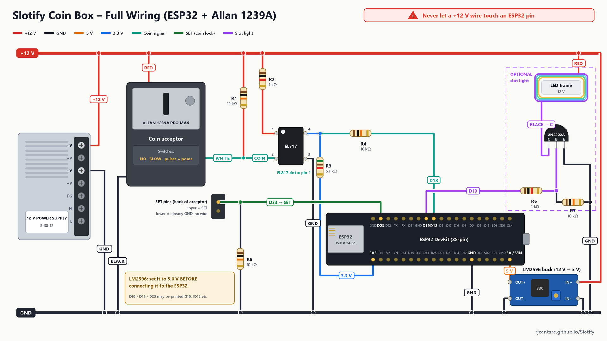

# ESP32 wiring — coin acceptor + LED frame



> The all-in-one diagram above shows the current hand-wired build; this file is the original breadboard design notes (also on the [wiring page](https://rjcantare.github.io/Slotify/wiring.html)). Other builds: [Slotify PCB](../../hardware/coin-box-board/README.md) (prototype) and the [Denz ready-made board](denz-subvendo-board.md) (untested).

Final hardware design for the coin pulse input and LED indicator output. Locked at end of S9 after bench-verified breadboard build. This file is the authoritative reference for the ESP32-side hardware that S10 firmware will target.

## Bill of materials

| Ref | Value | Package | 5-band colors | Purpose |
|---|---|---|---|---|
| R1 | 10 kΩ | ¼ W axial, ±1 % | Brown-Black-Black-Red-Brown | Pull-up on the COIN line; defines idle voltage when the acceptor's open-collector output is not pulsing |
| R2 | 1 kΩ | ¼ W axial, ±1 % | Brown-Black-Black-Brown-Brown | Current limit for the PC817/EL817 input LED; sets LED current to ~10 mA during a pulse |
| U1 | PC817 / EL817 | DIP-4 | — | Galvanic isolation + level shift between the acceptor's 12 V world and the ESP32's 3.3 V world |
| R3 | 10 kΩ | ¼ W axial, ±1 % | Brown-Black-Black-Red-Brown | Pull-up on the PC817 phototransistor collector; defines idle voltage on the 3.3 V side |
| R4 | 10 kΩ | ¼ W axial, ±1 % | Brown-Black-Black-Red-Brown | Series element of the anti-pitik RC low-pass filter |
| C1 | 100 nF (`104`) | Ceramic disc, non-polar | — | Shunt element of the anti-pitik RC low-pass filter (τ = 1 ms with R4) |
| R5 | 330 Ω | ¼ W axial, ±1 % | Orange-Orange-Black-Black-Brown | Current limit for the bench debug LED (sets LED current to ~4 mA from 3.3 V) |
| D1 | 5 mm red LED | through-hole | — | Bench-side debug indicator that mirrors the production frame LED state. Helps during firmware development. |
| R6 | 1 kΩ | ¼ W axial, ±1 % | Brown-Black-Black-Brown-Brown | Q1 base current limit; sets base drive to ~2.6 mA when GPIO 19 = HIGH |
| R7 | 10 kΩ | ¼ W axial, ±1 % | Brown-Black-Black-Red-Brown | Q1 base pull-down — holds Q1 OFF during ESP32 boot (~250 ms GPIO float window) so the production frame doesn't flicker on at every reset |
| R8 | 10 kΩ | ¼ W axial, ±1 % | Brown-Black-Black-Red-Brown | SET pulldown — holds the Allan inhibited while the ESP32 is reset, booting, unplugged, or offline |
| Q1 | 2N2222A | TO-92 NPN | — | Low-side switch for the Allan RGB acrylic frame (12 V, self-cycling controller, ~50–150 mA load) |

## External components

| Item | Notes |
|---|---|
| Allan 1239A Pro Max coin acceptor (HX-616 class) | 12 V DC, 4-wire cable. Programmed peso-count mode: ₱1 = 1 pulse, ₱5 = 5 pulses, ₱10 = 10 pulses, ₱20 = 20 pulses. SLOW DIP setting (65 ms pulse width). |
| Allan RGB acrylic frame LED | 12 V DC, 2-wire JST cable. Self-cycling RGB controller IC inside — applies power, runs its color cycle, removes power, turns off. No data signal required. |
| ESP32-WROOM-32 dev board | USB powered during bench testing. Production deployment can switch to LM2596s buck converter from the 12 V rail. |
| S-30-12 power supply | 12 V enclosed switching supply, 2.5 A rated. Standby 50 mA, peak coin-acceptor draw ~650 mA per datasheet. |

## Acceptor pin map

The acceptor's 4-wire cable:

| Wire | Connects to | Direction |
|---|---|---|
| **Red** | Top + rail (+12 V) | acceptor in |
| **Black** | Top − rail (GND) | acceptor in |
| **White** | COIN node (column 9 upper half) | acceptor OUT (open-collector pulse to GND) |
| **Gray** | unused | (parallel COUNTER output, not needed for our design) |

**Plus one separate Dupont F/F jumper** on the back-panel SET header (item ⑤ in the Allan datasheet, labelled "SET 設定" on the back, 2.54 mm pitch). Upper pin = signal (idle 3 V via internal pull-up); lower pin = GND, already common with the system GND through the main 4-wire harness and does not need separate wiring.

| Allan back-panel pin | Connects to | Direction |
|---|---|---|
| **SET upper (signal)** | ESP32 GPIO 23 and R8 10 kΩ pulldown | acceptor IN — LOW rejects coins; HIGH accepts coins |
| **SET lower (GND)** | R8 other leg, or any common GND rail | Keeps SET low by default when ESP32 is reset/offline |

## Allan RGB frame pin map

| Wire | Connects to | Direction |
|---|---|---|
| **Red** | Top + rail (+12 V) | frame in (positive supply) |
| **Black** | Q1 collector (column 46 lower half) | frame in (negative supply, switched by Q1) |

## ESP32 pin assignments

| ESP32 pin | Function | Direction | Connects to | Notes |
|---|---|---|---|---|
| `3V3` | Power supply | source | Bottom + rail | ESP32's onboard regulator output. |
| `GND` | Ground | — | Bottom − rail | Common ground with 12 V world via bridge jumper. |
| `GPIO 18` | `COIN_PULSE_IN` | digital input, interrupt-capable | Column 20 lower half | Idle HIGH (~3.3 V via R3+R4 pull-up); falling edge per coin pulse. Software debounce required in firmware. |
| `GPIO 19` | `COIN_LED_OUT` | digital output | Column 25 lower half | HIGH = LEDs on (bench + frame). LOW = LEDs off. Drives ~7 mA total. |
| `GPIO 23` | `ACCEPTOR_INHIBIT` | digital output | Same node as Allan SET upper and R8 pulldown | LOW = acceptor refuses coins. HIGH = acceptor accepts coins. Firmware drives HIGH only during server-issued LED-on (claim grant) windows; R8 keeps reset/offline fail-safe as reject. |

**Why GPIO 18, 19, and 23 specifically:** all non-strapping pins (boot-safe), GPIO 18 is interrupt-capable for the pulse input, GPIO 23 is on the same side of the dev board as 18/19 so the wire run is short. Safe alternatives if any of them are unavailable on a given dev board variant: GPIO 4, 13, 14, 16, 17, 21, 22, 25, 26, 27, 32, 33. Avoid GPIO 0/2/5/12/15 (strapping), GPIO 6–11 (flash), GPIO 34–39 (input-only — can't be used for the LED output or the inhibit output, but could substitute for the pulse input if needed).

## Power supply pin map

S-30-12 PSU screw terminals:

| Terminal | Connects to |
|---|---|
| `L` / `N` / `⏚` | AC 220 V mains (live / neutral / earth) |
| `+V` | Top + rail (+12 V) |
| `−V` | Top − rail (GND) |

## Internal breadboard jumpers

Four jumpers tie the circuit together. Their placements aren't decorative — each one is required for the design to work.

| # | From | To | Purpose |
|---|---|---|---|
| 1 | Top − rail | Bottom − rail | GND bridge at column 1 — joins the 12 V world's GND with the 3.3 V world's GND. Without this, the optocoupler cannot bridge logic levels between the two domains. |
| 2 | Column 9 lower half | Bottom − rail | Grounds the PC817's phototransistor emitter (pin 3). |
| 3 | Column 44 lower half | Bottom − rail | Grounds Q1's emitter. |
| 4 | Column 25 lower half | Column 35 lower half | Extends the L node across the gap — R5 attaches at column 25, R6 at column 35, this jumper makes them one electrical node. (Needed because a ¼ W resistor can't reach 20 columns directly.) |

## ASCII schematic

```
                              +12 V (S-30-12 PSU)
                                       │
            ┌───────┬─────────────┬───────────────────┐
            │       │             │                   │
           R2      R1   Acceptor RED          Allan frame RED
           1k     10k                                  │
            │       │                                  │
            │       │                                  │
            │       │   ┌── Acceptor WHITE (COIN, open-collector)
            │       └───┤
            │           │ COIN node (column 9 upper)
            └───────────┴── EL817 pin 2 (cathode)
                            │
                          [LED]   (forward-biased when acceptor pulls COIN LOW)
                            │
                          EL817 pin 1 (anode) ── from R2

       ════ galvanic isolation across the chip body ════

                          EL817 pin 4 (collector)
                            │
                            ├── R3 (10 kΩ) ── +3.3 V (ESP32)
                            │
                            ├── R4 (10 kΩ, RC filter series)
                            │       │
                            │       ├── C1 (100 nF) ── GND
                            │       │
                            │       └── ESP32 GPIO 18  (COIN_PULSE_IN)
                            │
                          EL817 pin 3 (emitter) ── GND


       ESP32 GPIO 19 (COIN_LED_OUT) ── L node (column 25 ↔ column 35)
                                            │
                                            ├── R5 (330 Ω) ── D1 (red LED) ── GND
                                            │
                                            └── R6 (1 kΩ) ── Q1 base
                                                                  │
                                                          R7 (10 kΩ) ── GND
                                                                  │
                                                          Q1 emitter ── GND
                                                          Q1 collector ── Allan frame BLACK


              GND ════ top blue rail ──[bridge col 1]── bottom blue rail
              (PSU −V, acceptor BLACK, ESP32 GND all common)
```

## Design notes

### Why the anti-pitik RC filter passes coin pulses but blocks injection attacks

Time constant `τ = R4 × C1 = 10 kΩ × 100 nF = 1 ms`. At the ESP32 GPIO input:

| Pulse width | Voltage at GPIO during pulse | Result |
|---|---|---|
| 25 ms (FAST acceptor) | reaches ~0.04 V within 3 ms of edge | clean LOW — detected |
| 45 ms (MEDIUM) | reaches ~0.04 V faster proportionally | clean LOW — detected |
| 65 ms (SLOW, current setting) | reaches ~0.04 V | clean LOW — detected |
| 1 ms (piezo lighter spark, fast EMI) | reaches ~1.2 V — above LOW threshold | rejected |
| 100 µs (very fast EMI / piezo) | reaches ~3.0 V — basically unchanged | rejected solidly |

S11 firmware adds software debounce on top of this hardware filter. The filter's job is to keep the worst of the noise from even reaching the GPIO interrupt; firmware does the per-pulse pattern validation (denomination encoding).

### Why R7 is the boot-safety insurance

ESP32 GPIOs float during the first ~250 ms of every boot/reset, before firmware initializes them. Without R7, Q1's base would float — and even a few microamps of leakage can be amplified by Q1's gain into enough collector current to light the frame's controller IC. The frame would flicker on at every power-up and every random reset, confusing the user about whether they have an active claim. R7 holds the base at solid GND during that window. R7 is non-negotiable.

### Why galvanic isolation matters even with shared GND

The optocoupler provides surge protection, not ground isolation. The two GND rails are intentionally bridged. The protection is: if the acceptor faults (output transistor shorts 12 V to the COIN line), the EL817's input LED takes the surge and dies (~₱5 part), while the ESP32 is fully isolated electrically from the 12 V world and survives.

### Why the inhibit wire is the primary noise defense (added 2026-05-18)

Without inhibit gating, the acceptor's output transistor is live 24/7 — every noise transient on the 12 V rail or shared GND can flip it briefly and produce a FALLING edge at the ESP32 that looks like a coin pulse. The S11 firmware caught these with warm-up + count<2 + debounce + INTER_PULSE_MAX filters, but the noise was reaching the ESP32 every time. After reverse-engineering the AdoFox firmware (basic-wiring PDF in `ProjectContext/AdoFirmwareref/ado-wireless-basic.pdf`), the real architectural fix surfaced: the Allan's SET pin is an *inhibit input* on its back panel, and pulling it LOW puts the acceptor's output stage in reset so it cannot fire at all. We drive that pin from GPIO 23 and add R8 as a hardware pulldown, so the physical default is reject unless firmware actively drives SET HIGH during a claim. Outside the claim window, phantom pulses are physically blocked rather than software-filtered. The S11 software filters now serve as defense-in-depth during the brief active claim windows.

Polarity on the Allan is inverted from AdoFox's "Universal Coin Acceptor" (which used HIGH = inhibit). The Allan is LOW = inhibit, HIGH = active. Earlier breadboard wiring left SET floating during reset, which allowed the acceptor to swallow coins while ESP32 was offline. R8 fixes that: reset/offline now defaults to reject, and firmware drives GPIO23 HIGH only while the server has granted an Insert Coin window.

### Acceptor calibration

Per HX-616 manual programming sequence, the Allan was configured at end of S9 with these channels:

| Channel | Coin variants accepted | Output pulses |
|---|---|---|
| H1 | Old + new ₱1 (single shared channel) | 1 |
| H2 | New ₱5 | 5 |
| H3 | Old ₱5 | 5 |
| H4 | New ₱10 | 10 |
| H5 | Old ₱10 | 10 |
| H6 | ₱20 | 20 |

All channels use F = 8 (accuracy). 20 samples per channel.

Splitting old/new variants of the ₱5 and ₱10 into separate channels (with the same output pulse count per denomination) reflects the fact that PH coinage went through generational design changes — the old round ₱5 vs. the new nonagonal bimetallic ₱5 have very different physical signatures and a single shared channel can't recognize both reliably. Server-side via MQTT this is now peso-count mode: 6 internal acceptor channels, pulse count equals pesos, so `₱1 = 1 pulse, ₱5 = 5, ₱10 = 10, ₱20 = 20`.

If H1 (combined old+new ₱1) shows rejection problems in service, split it the same way as H2/H3 and H4/H5.

DIP switch settings during S9 bench testing: NO (Normal Open output), SLOW (65 ms pulse). FAST or MEDIUM may be revisited during S11 firmware bring-up if 65 ms turns out to be more pulse time than the firmware needs.
