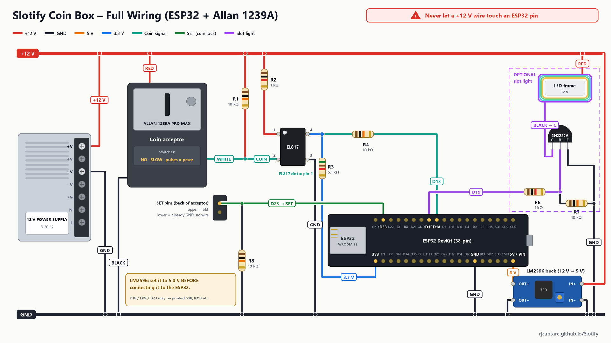

# Production wiring (coin-box install)



> The all-in-one diagram above is the current hand-wired build (also on the [wiring page](https://rjcantare.github.io/Slotify/wiring.html)). Other builds: [Slotify PCB](../../hardware/coin-box-board/README.md) (prototype) and the [Denz ready-made board](denz-subvendo-board.md) (untested).

Production-safe layout to take the S9 bench design from breadboard onto a
perfboard mounted inside the actual coin box. It removes only bench-only or
duplicate parts. The anti-pitik shunt cap C1 is left unpopulated — the board
validated cleanly without it — with its pad reserved for a quick re-add.

**Reference:** `esp32-wiring.md` (the bench design) and `coin-acceptor-spec.md`
(software defense layers, S12 stress-test results).

For the live row/column perfboard walk-through, use
`perfboard-build-task.md`.

---

## TL;DR — what changes vs the breadboard

| Bench part | Keep / cut | Reason |
|---|---|---|
| R1 10 kΩ — COIN line pull-up | **Keep** | Without it, the acceptor's open-collector pulse can't drive the EL817 input. Cheap insurance. |
| R2 1 kΩ — EL817 LED current limit | **Keep — non-negotiable** | Drops 11 V across itself so the EL817 LED sees ~10 mA. Cut it and the EL817 input LED burns out the first time a coin drops. |
| U1 EL817 / PC817 opto | **Keep — non-negotiable** | Galvanic isolation. If the acceptor shorts 12 V to its COIN output (failure mode that has happened on cheap units), this is the only thing standing between the surge and the ESP32. |
| R3 + parallel-R3 (post-S20.9 mod) | **Consolidate to 1× 5.1 kΩ** | The bench is two 10 kΩ in parallel = effectively 5 kΩ. Replace with a single 5.1 kΩ (E12 value) for the same electrical behavior, one fewer part. |
| R4 10 kΩ — series resistor into GPIO18 | **Keep** | Retained as a plain series resistor. With C1 unpopulated it does no filtering on its own; noise immunity comes from the SET-pin inhibit + the stiff 5.1 kΩ pull-up + firmware debounce / burst-splitters. |
| C1 100 nF — anti-pitik RC shunt | **Not populated — pad reserved** | Removed when the opto pull-up was stiffened to 5.1 kΩ; the S12 worst-case stress test (LED frame attached, inhibit OFF, 250 s) logged zero phantom pulses without it. Pad left open so the RC filter can be re-added in ~2 min if a 24h in-box soak shows noise. |
| R5 330 Ω — bench debug LED resistor | **Cut** | Bench-only. |
| D1 5 mm red LED — bench debug | **Cut** | The Allan RGB acrylic frame is the production indicator. The bench LED was only useful for debugging firmware GPIO 19 toggles without the frame plugged in. |
| R6 1 kΩ — Q1 base | **Keep** | Limits base current to ~2.6 mA so Q1 stays in saturation without overdriving. |
| R7 10 kΩ — Q1 base pull-down | **Keep — non-negotiable** | Holds Q1 OFF during the ~250 ms ESP32 boot window. Without it the frame flickers on at every power-up and every reset, confusing the customer. |
| R8 10 kΩ — SET pulldown | **Keep — non-negotiable** | Fail-safe rejects coins whenever the ESP32 is reset/offline/unpowered. Removing it means the acceptor swallows coins with no MQTT publish during a crash — direct money loss. |
| Q1 2N2222A — frame switch | **Keep** | ESP32 GPIO can't drive the frame's 12 V/~100 mA load directly. |

---

## Production BOM (after the cuts above)

| Qty | Part | Value | Package |
|---|---|---|---|
| 1 | ESP32-WROOM-32 dev board | — | DIP-38 breakout, powered via VIN/5V (not USB) |
| 1 | **LM2596 HW-411 buck converter module** | **12 V in → 5 V out** | preassembled board with pot + screw terminals |
| 1 | EL817 / PC817 optocoupler | — | DIP-4 |
| 1 | 2N2222A transistor | NPN | TO-92 |
| 3 | Resistor | 10 kΩ ¼ W | axial (R1, R7, R8) |
| 2 | Resistor | 1 kΩ ¼ W | axial (R2, R6) |
| 1 | Resistor | 5.1 kΩ ¼ W | axial (R3) |
| 1 | Resistor | 10 kΩ ¼ W | axial (R4 series resistor into GPIO18) |
| 0 | Capacitor | 100 nF ceramic | disc (C1) — optional; pad reserved, not populated |
| 1 | Perfboard | ~30 × 70 mm | through-hole |
| 1 | 2-pin terminal block (12 V in from PSU) | 5.08 mm pitch | screw |
| 2 | 4-pin headers (acceptor + frame harness) | 2.54 mm | optional |

Total active components: **11** — R4 is kept as a plain series resistor; C1 is
not populated (its pad is reserved). One ¼-W resistor strip + one EL817 + one
TO-92 + one LM2596 module + the ESP32 module. The 100 nF cap is left off the
board unless a soak test later shows noise.

**Single power supply.** The S-30-12 PSU's +12 V rail feeds three things in
parallel: the coin acceptor, the Allan RGB frame, and the LM2596 buck
converter that produces 5 V for the ESP32's VIN pin. No USB cable to the
dev box in production — reflashing happens over WiFi via OTA (see "OTA
upload" section in `RentalCoinAcceptor/platformio.ini` and the wiring map
below).

---

## Wiring map (point-to-point on perfboard)

```
+12 V (terminal block IN+, from S-30-12 PSU)
    ├── Acceptor RED
    ├── Allan frame RED
    ├── LM2596 IN+               ┐
    │                            │ on the LM2596 module
    │                            │ (HW-411 PCB)
    │                            ▼
    │   LM2596 OUT+ (5.0 V) ───┐
    │                          │
    │                          └── ESP32 VIN  (or 5V pin)
    │
    └── R1 (10 kΩ) ── COIN node ── Acceptor WHITE
                              └── R2 (1 kΩ) ── EL817 pin 1 (anode)
                              EL817 pin 2 (cathode) ── COIN node

3.3 V (from ESP32 3V3 pin — generated by the ESP32 board's onboard
       AMS1117 from the 5 V coming in on VIN)
    └── R3 (5.1 kΩ) ── OPTO_OUT node
                       ├── EL817 pin 4 (collector)
                       └── ESP32 GPIO 18  (COIN_PULSE_IN)
                       (R4 series only here; C1 pad reserved, not populated)

ESP32 GPIO 19  (COIN_LED_OUT)
    └── R6 (1 kΩ) ── Q1 base
                     ├── R7 (10 kΩ) ── GND
                     ├── Q1 emitter ── GND
                     └── Q1 collector ── Allan frame BLACK

ESP32 GPIO 23  (ACCEPTOR_INHIBIT)
    ├── R8 (10 kΩ) ── GND
    └── Allan SET pin (back-panel header)

GND (terminal block IN−, from S-30-12 PSU −V)
    ├── Acceptor BLACK
    ├── EL817 pin 3 (emitter)
    ├── LM2596 IN−
    ├── LM2596 OUT−
    ├── ESP32 GND
    └── Allan SET lower pin
    (one common rail; do NOT split — the EL817 is the only galvanic break,
     and even there both sides need to share GND for the level shift to work.
     LM2596 IN− and OUT− are internally tied on the HW-411 module; bonding
     them on the perfboard is belt-and-suspenders, not strictly required.)
```

---

## LM2596 HW-411 setup — adjust the output BEFORE wiring to the ESP32

The HW-411 ships with the on-board trim pot at an unknown position. Out of
the box it might pass close to the input voltage straight through — feeding
12 V into the ESP32's 5 V pin instantly kills the ESP32. **Calibrate the
module first, alone, with no load.**

1. Wire only the 12 V input side: PSU +12 V → IN+, PSU −V → IN−.
2. Put a multimeter on the OUT+ / OUT− screw terminals, set to DC volts.
3. Apply 12 V to the input.
4. Read the output. If it isn't ~5.0 V, turn the blue 10-turn trim pot:
   - **Clockwise raises** the output. Counter-clockwise lowers.
   - The pot is multi-turn — full sweep is ~10 full rotations. Make small
     adjustments and re-read.
5. Stop when the multimeter reads **5.0 ± 0.1 V**. Below 4.7 V the ESP32's
   AMS1117 may brown out under WiFi TX bursts; above 5.5 V you're outside
   the dev-board VIN spec.
6. Remove power, then wire OUT+ → ESP32 VIN and OUT− → ESP32 GND.
7. Re-apply 12 V. ESP32 should boot normally (onboard 3V3 LED lights up,
   USB-UART chip enumerates if a USB cable is also connected, serial
   monitor shows the firmware boot banner).

If you ever swap the LM2596 module, re-do steps 1–6 before connecting the
new one to the ESP32. They DO sometimes ship pre-calibrated to 5 V but
trusting that has cost more ESP32s than the 60 seconds of calibration.

---

## Mounting recommendations

1. **Perfboard, not screw terminals everywhere.** Solder R1/R2/U1/R3/R6/R7/R8/Q1
   onto a 30×70 mm perfboard. Use header sockets (DIP-38 female) for the ESP32
   so you can swap it without re-soldering on a firmware update or hardware
   fault.

2. **Single terminal block for power in.** One 2-pin 5.08 mm screw terminal on
   the perfboard takes the 12 V wires from the PSU. Everything 12 V-side fans
   out from there.

3. **Acceptor harness on a 4-pin header.** Red / Black / White / Gray as a
   strip. Gray isn't used by the design but it's fine to bring it onto the
   perfboard and leave unconnected — keeps the harness one piece.

4. **Frame harness on a 2-pin JST or screw block.** Red goes to +12 V, Black
   to Q1 collector. Don't reverse — the frame controller is polarity-sensitive
   and you'll see fireworks.

5. **Allan SET signal on a separate F/F Dupont jumper to the back panel.** Two
   wires: signal to GPIO 23 (via R8 on the perfboard), and the SET lower pin
   shares the system GND through the main 4-wire harness, so it doesn't need
   a separate ground wire to the perfboard.

6. **Wire routing inside the box:**
   - Twist the acceptor's WHITE (COIN signal) with one of the GND wires
     running back. Reduces inductive pickup.
   - Run the COIN signal **away from** the LED frame's power wires. The
     frame controller chops the 12 V to drive its color cycle; the switching
     transients couple into nearby wires. Bench measurement showed this was
     the dominant noise source pre-inhibit.
   - Use **shielded cable** for the COIN line if the run inside the box is
     longer than ~30 cm. Common foil or braid, drain to GND at the
     perfboard side only.

7. **Hot-glue or 3M VHB the perfboard** to the inside wall of the coin box.
   Standoffs are cleaner but the box vibrates when coins drop — adhesive
   absorbs that without rattling the board against the wall.

---

## Validation steps before screwing the box shut

1. **Powered-but-idle (3 min):** Apply 12 V, leave ESP32 alone, no claim. Watch
   `mosquitto_sub -t 'rental/coinacceptor/+/pulse'` from the server. **Pass:**
   zero pulse messages. **Fail:** any pulse without a coin drop → noise from
   the layout. Move the COIN wire farther from the frame power and check the
   grounding; if noise persists, populate the reserved C1 pad to restore the
   R4+C1 RC filter.

2. **Power-cycle 3× with the frame attached:** Pull 12 V power for 5 s, reapply.
   Watch the frame. **Pass:** frame stays OFF until you trigger a claim.
   **Fail:** frame flickers at power-up → R7 missing or wrong value.

   *Sanity-check the LM2596 output the first time you do this:* meter on
   the buck-converter output terminals should read 5.0 ± 0.1 V the whole
   time. If it drifts on cold-start, the pot wasn't locked — re-trim and
   re-verify before screwing the box shut.

3. **Reset-while-inhibit-released:** Trigger a claim (LED on, inhibit released),
   then physically reset the ESP32 mid-claim. Watch the acceptor. **Pass:**
   coins drop straight through the reject slot. **Fail:** acceptor takes a
   coin during the reset window → R8 missing or wrong polarity.

4. **24-hour soak:** Leave the system in normal operation for a day. Check
   the server's event_log:
   ```
   SELECT COUNT(*) FROM event_log WHERE event_type = 'coin_credit'
     AND ts >= datetime('now', '-1 day');
   ```
   Compare to the manual coin count. **Pass:** counts match. **Fail:**
   server has extra coin_credit rows → noise sneaked through during a claim
   window. Re-check COIN wire routing and grounding; this is also the moment to
   populate the reserved C1 pad and restore the R4+C1 RC filter, before
   screwing the box shut.

5. **Coin denomination test:** Drop one each of ₱1, ₱5, ₱10, ₱20 within a
   single claim window. Server should show `coin_credit` rows with
   `amount_pesos` exactly 1/5/10/20. Any wrong-denomination credit means a
   pulse-count miscount — re-check the acceptor's DIP settings (SLOW mode,
   NO output polarity).

If all 5 pass, screw the box shut.

---

## What gets harder once it's in the box

- **Reflashing is now OTA-only.** USB is no longer wired in production —
  the ESP32 is powered from the 12 V rail through the LM2596 buck. The
  firmware wires `ArduinoOTA` and exposes itself on mDNS as `coin-01.local`
  port 3232, password-protected by the `OTA_PASSWORD` define in
  `include/config.h`. From the dev box:

  ```powershell
  $env:RENTAL_COIN_OTA_PASSWORD = "<your OTA password>"
  cd C:\Projects\RentalCoinAcceptor
  pio run -e esp32dev-ota -t upload
  ```

  On every OTA-start the firmware drops the acceptor inhibit + detaches
  the pulse ISR + kills the LED so a coin drop mid-flash can't corrupt the
  write. On success the ESP32 reboots into the new firmware automatically.
  On failure (auth, network drop, bad checksum) the ISR re-attaches and
  the device continues operating on the old firmware — safe to retry.

  **Fallback:** if WiFi or OTA breaks (bad config baked into firmware,
  AP password change, etc.) you'll need to physically reach the USB port
  to recover. Either leave a small access flap in the coin box's outer
  shell aligned with the USB-C/micro-USB jack, or plan a one-time
  unmount when WiFi changes. The whole point of OTA is to make this rare.

- **No more easy probing.** Bring out two test points on the perfboard:
  - **TP1 = GPIO 18 (COIN_PULSE_IN)** — to confirm pulses reach the ESP32
    on bench.
  - **TP2 = GPIO 23 (ACCEPTOR_INHIBIT)** — to confirm inhibit is gating.
  Solder female-header sockets. A 'scope or logic analyzer clips on without
  opening the box.

- **No serial monitor on production.** Once you trust the firmware, the
  serial output is dead weight. Consider pulling `Serial.begin` from
  `setup()` for production builds, or keep it but accept the boot-time prints
  going nowhere.
