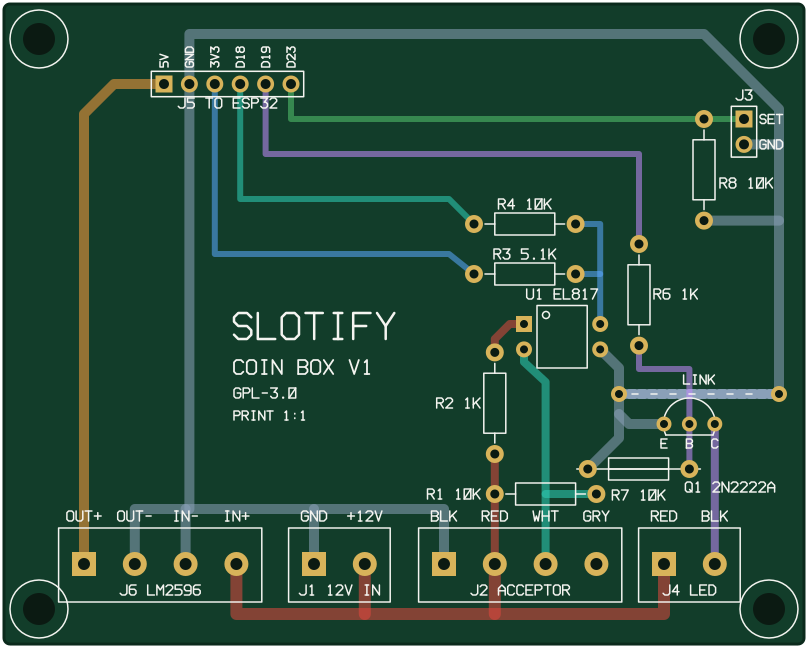

# Coin box board (V1)

A small 80 × 64 mm board that replaces the breadboard or perfboard in the coin box. Everything plugs into screw terminals and pin headers, so there's no loose wiring.



> **Status: prototype, not yet manufactured.** The layout passes this folder's
> own checks: every connection is complete, and no two different connections
> are closer than 0.3 mm. The circuit matches the bench-tested wiring in
> [docs/hardware/production-wiring.md](../../docs/hardware/production-wiring.md).
> Order a small batch first and test one board fully before building more.
> If you build it, please send a [tester report](../../CONTRIBUTING.md).

## What's on the board

| Part | Job |
|------|-----|
| U1 EL817 + R1, R2 | Coin pulses from the acceptor, isolated from the ESP32 |
| R3, R4 | Pull-up and series resistor into ESP32 **D18** |
| R8 | Keeps the slot locked (SET low) whenever the ESP32 is off or restarting |
| Q1 2N2222A + R6, R7 | Switches the 12 V LED frame from ESP32 **D19** |

The **ESP32** and the **LM2596** module stay off the board and connect by wire. ESP32 boards come in different widths and pin orders, so wiring them keeps this board compatible with any of them.

## Connectors

| | Pins (left → right) | Connect to |
|---|---|---|
| **J1** 12V IN | GND, +12V | 12 V power supply −V / +V |
| **J6** LM2596 | OUT+, OUT−, IN−, IN+ | The LM2596 module's 4 pads. **Set it to 5.0 V before connecting.** |
| **J2** ACCEPTOR | BLK, RED, WHT, GRY | Allan coin acceptor harness (GRY is not used) |
| **J4** LED | RED, BLK | LED frame (polarity matters) |
| **J5** to ESP32 | 5V, GND, 3V3, D18, D19, D23 | ESP32 VIN, GND, 3V3, GPIO18, GPIO19, GPIO23 (Dupont jumpers) |
| **J3** SET | SET (top), GND | Allan back-panel SET header: upper pin to SET. GND is optional. |

## Option A: order it from a PCB maker

1. Download [`output/slotify-coin-board-gerbers.zip`](output/slotify-coin-board-gerbers.zip).
2. Upload it to JLCPCB, PCBWay or a similar service. The defaults work: **2 layers, 1.6 mm, HASL, any colour**. The board is 80 × 64 mm, and the minimum order is usually 5 pieces.
3. The two **LINK** pads are already joined by a copper trace on the top layer, so you don't need a wire.

## Option B: etch it yourself

1. Print page 1 of [`output/slotify-coin-board-print.pdf`](output/slotify-coin-board-print.pdf) at **100 % / Actual size**. Check that the bar measures exactly **50 mm**.
2. Toner transfer: print it as-is (**not mirrored**) onto glossy or transfer paper, iron it onto **single-sided** copper board, etch, then clean off the toner.
3. Drill using the white dots as centers:

   | Drill | For |
   |------:|-----|
   | 0.8 mm | U1, Q1, LINK |
   | 0.9 mm | Resistors |
   | 1.0 mm | J3, J5 headers |
   | 1.2 mm | Screw terminals |
   | 3.2 mm | 4 corner mounting holes |

4. Solder a short wire between the two **LINK** pads on the component side. It joins the right-hand ground to the rest of the ground.

## Assembly order

Lowest parts first:
1. **Resistors**, matching values to the labels (R1 10K, R2 1K, R3 5.1K, R4 10K, R6 1K, R7 10K, R8 10K).
2. **LINK** wire (home-etched boards only).
3. **U1 EL817**: the dot on the chip goes on the **square** pad.
4. **Q1 2N2222A**: the flat side faces down towards J4, matching the outline. Check that your part's legs are E-B-C.
5. **Pin headers** J5 and J3.
6. **Screw terminals**, with the wire openings facing the board edge.

## Before powering up

- With **nothing connected**, measure between J1 +12V and GND. It must **not** read as a short.
- Connect only J1 and J6 (with the LM2596 set to 5.0 V), then check for **5.0 V** between J5 5V and GND.
- Then connect the ESP32, the acceptor and the LED frame, and run the tests in [docs/OWNER-GUIDE.md §2.7](../../docs/OWNER-GUIDE.md#27-test-before-closing-the-box).

If phantom coins show up, solder a 100 nF capacitor between J5 **D18** and **GND** on the underside of the header. That's the optional C1 from the wiring notes.

## Editing the board

Everything is generated by [`generate.py`](generate.py), which uses plain Python 3 with no extra packages:

```
python generate.py
```

It reruns all the checks and rebuilds every file in `output/`. If any check fails, it stops without writing files.
